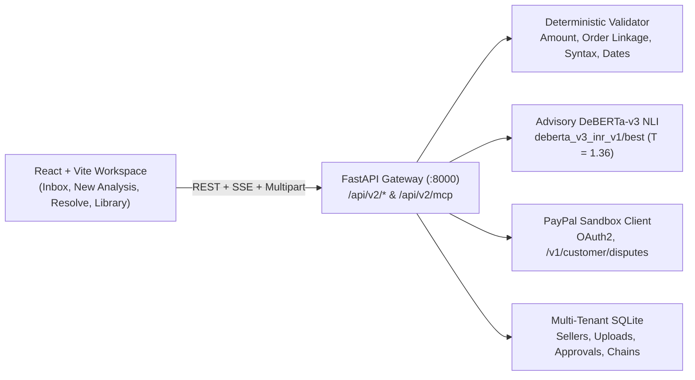

# ProofLedger — PayPal Dispute Rescue

**Deterministic-first PayPal dispute evidence verification and grounded merchant response workspace**, scoped to **Merchandise or Service Not Received (`MERCHANDISE_OR_SERVICE_NOT_RECEIVED`)** disputes.

ProofLedger shows merchants what submitted evidence actually proves, what remains unverified, and what is still missing — pairing deterministic verification rules and a step-by-step Delivery Verification Journey with advisory fine-tuned DeBERTa-v3 semantic alignment and mandatory server-side SHA-256 merchant approval.

---

## Key Capabilities & Safety Guarantees

- **Deterministic Rules-First Authority**: Order linkage, PayPal payment capture matching, amount/currency consistency, chronological date checks, and tracking syntax (`FORMAT_VALID`) are enforced deterministically.
- **Provenance-Separated Delivery Journey**: Visually separates **Merchant Attestation & Uploads** (`MERCHANT_ATTESTATION / FORMAT_VALID`) from **Independent Carrier Verification** (`LOOKUP_NOT_CONFIGURED`). Valid tracking syntax or uploaded files never fabricate physical carrier pickup (`NOT VERIFIED`) or green `Delivered` confirmation.
- **Honest Non-OCR Document Uploads**: Uploaded PDF/JPG/PNG files are persisted with **`SHA-256 integrity verified`** and explicitly marked **`CONTENT_NOT_EXTRACTED`** — file bytes are hashed for integrity only, never OCR-parsed or read as verified delivery proof.
- **Mandatory Server-Side SHA-256 Approval Sealing**: Submitting evidence requires explicit merchant review and server-side digest binding (`POST /api/v2/disputes/{dispute_id}/approve-evidence`). Editing a single character in the draft after approval immediately invalidates the seal (`HTTP 409 STALE_OR_MODIFIED_APPROVAL`).
- **Strict Local Demo vs. Live PayPal Separation**: Live PayPal Sandbox REST API cases (`PAYPAL_SANDBOX_LIVE`) are separated from local test scenarios (`LOCAL DEMO — NOT A PAYPAL DISPUTE`), which record `LOCAL_SIMULATED_SUBMISSION` locally and are rejected (`HTTP 400 LOCAL_DEMO_NOT_LIVE_PAYPAL`) if `require_live_paypal=true`.
- **Fail-Closed AI Loading**: Defaults to `ai/artifacts/candidates/deberta_v3_inr_v1/best` (overridable via `PROOFLEDGER_MODEL_PATH`) and fails closed with `MODEL_UNAVAILABLE` if weights are absent, with zero silent fallback to legacy checkpoints.

---

## System Architecture



Detailed architectural contracts and routes are documented in [`docs/ARCHITECTURE.md`](docs/ARCHITECTURE.md) and [`docs/API_REFERENCE.md`](docs/API_REFERENCE.md).

---

## AI Evidence Reasoning & Model Limitations

> **AI Evidence Reasoning — ProofLedger**
>
> ProofLedger uses a fine-tuned DeBERTa-v3 model to assist with semantic alignment between merchant claims and submitted evidence.
>
> The candidate achieved **86.00% accuracy** and **0.8589 Macro F1** on an internally curated 450-example EvidenceBench-v2 test split. This benchmark contains synthetic merchant scenarios and transformed FEVEROUS examples; it is not an independent real-world PayPal merchant dispute evaluation.
>
> Evaluation identified a significant weakness in the transformed FEVEROUS subset, including false contradiction predictions. Accordingly, model predictions remain advisory and cannot override deterministic transaction verification, delivery evidence requirements, or mandatory merchant approval.
>
> The production workflow retains a rules-first safety architecture. Human review and explicit merchant approval are required before evidence submission.

### Independent Unseen Generalization Audit (`proofledger_unseen_v1`)

After freezing all weights, an independent leak-free synthetic audit (`N = 600` unseen claims across 14 novel scenario families + `N = 72` adversarial stress suite; 0 exact or near-duplicate overlaps against 23,158 historical rows) was evaluated in [`FINAL_RELEASE/INDEPENDENT_GENERALIZATION_AUDIT/INDEPENDENT_GENERALIZATION_REPORT.md`](FINAL_RELEASE/INDEPENDENT_GENERALIZATION_AUDIT/INDEPENDENT_GENERALIZATION_REPORT.md):

| System Evaluated (`N = 600`) | Accuracy | Macro F1 | `INSUF -> CON` Rate | Overall FCR | Calibration ECE |
| :--- | ---: | ---: | ---: | ---: | ---: |
| **Candidate (`deberta_v3_inr_v1/best`)** | **82.00%** | **0.8226** | 11.50% | **5.75%** | 0.1000 (raw) |
| **Production Hybrid (`Rules + Candidate`, `T=1.36`)** | **82.00%** | **0.8226** | 11.50% | **5.75%** | **0.0572** |
| Pretrained (`MoritzLaurer/DeBERTa-v3-base-mnli-fever-anli`) | 66.00% | 0.6484 | 34.50% | 21.75% | 0.2594 |
| Legacy Checkpoint (`ai/artifacts/best_model`) | 36.67% | 0.3891 | 66.00% | 62.00% | — |
| Rules-Only Deterministic Baseline | 35.67% | 0.2132 | 0.00% | 0.00% | — |

- **Adversarial Robustness (`N = 72`) & Counterfactual Probes (`10` pairs)**: Candidate **86.11%** accuracy (Production Hybrid **84.72%**, `9/10` probes) vs. **66.67%** Pretrained (`7/10` probes).
- **Documented Limitations**: `GENERALIZATION DEMONSTRATED ON INDEPENDENT SYNTHETIC DATA` / `REAL-WORLD GENERALIZATION NOT ASSESSED`. Notable weaknesses remain on chronological prose ordering (`33.3%`), subtle SKU variant mismatches (`52.4%`, `CONTRADICTED` recall `69.0%`), and synthetic in-house authorship rather than real PayPal dispute logs.

---

## Repository Structure

```
.
├── backend/                FastAPI routes, multi-tenant SQLite services, PayPal & MCP clients, backend tests
├── frontend/               React 18 + Vite + Tailwind UI, components, unit tests
├── ai/                     Model inference wrapper, configs, benchmarks, and unit tests
├── src/                    Shared domain helpers & historical training utilities
├── scripts/                Evaluation, smoke test, and headless Chrome E2E verification scripts
├── tools/                  External signing and PayPal Agent Toolkit bridge utilities
├── docs/                   Architecture, API reference, and documentation index
├── FINAL_RELEASE/          Frozen model reports, generalization audit, checksums, and demo script
├── README.md
└── SETUP.md
```

---

## Quick Start

See [`SETUP.md`](SETUP.md) for environment setup, candidate weights placement (`deberta_v3_inr_v1/best/model.safetensors`), and troubleshooting.

```bash
# 1. Configure environment variables
cp .env.example .env

# 2. Install Python dependencies
pip install -r requirements.txt

# 3. Start Backend API (port 8000)
PYTHONPATH="$(pwd):$(pwd)/ai:$(pwd)/ai/src" \
python3 -m uvicorn backend.main:app --host 127.0.0.1 --port 8000

# 4. Start Frontend UI (new terminal, port 5173)
cd frontend && npm install && npm run dev -- --host 127.0.0.1 --port 5173
```

Open `http://127.0.0.1:5173` in Chrome (API docs at `http://127.0.0.1:8000/docs`).

---

## Verification Commands

```bash
# Frontend unit rules + production build
node --test frontend/tests/frontend_rules.test.mjs
cd frontend && npm run build

# Offline AI + backend test suites (excludes live PayPal network tests)
python3 -m pytest ai/tests/ backend/test_sprint_final_features.py \
  backend/test_paypal_dispute_rescue_suite.py backend/test_phase2_6_security.py \
  backend/test_phase2_5_acceptance.py backend/test_calibration_and_metrics_consistency.py \
  backend/test_all_module_imports.py backend/test_backend_api.py \
  backend/test_comprehensive_audit_remediation.py \
  backend/test_cryptographic_trust_boundary_7_attacks.py \
  backend/test_lifecycle_and_provenance_audit.py \
  backend/test_production_credential_isolation.py -q

# Application staging & fail-closed smoke test
python3 scripts/run_smoke_test.py

# Live headless Chrome E2E verification across 1440x900, 1280x800, 390x844
python3 scripts/e2e_browser_verify.py
```

---

## Documentation Index

| Document | Purpose |
| :--- | :--- |
| [`SETUP.md`](SETUP.md) | Installation, `.env` configuration, model weights placement, test commands |
| [`docs/README.md`](docs/README.md) | Complete repository documentation index |
| [`docs/ARCHITECTURE.md`](docs/ARCHITECTURE.md) | End-to-end verification pipeline, SSE stages, provenance state machine |
| [`docs/API_REFERENCE.md`](docs/API_REFERENCE.md) | REST, SSE, and MCP JSON-RPC endpoint reference |
| [`FINAL_RELEASE/FINAL_MODEL_REPORT.md`](FINAL_RELEASE/FINAL_MODEL_REPORT.md) | Candidate model metrics, lineage hashes, and error disclosures |
| [`FINAL_RELEASE/INDEPENDENT_GENERALIZATION_AUDIT/INDEPENDENT_GENERALIZATION_REPORT.md`](FINAL_RELEASE/INDEPENDENT_GENERALIZATION_AUDIT/INDEPENDENT_GENERALIZATION_REPORT.md) | Unseen `N = 600` & adversarial `N = 72` evaluation report |
| [`FINAL_RELEASE/DEMO_SCRIPT.md`](FINAL_RELEASE/DEMO_SCRIPT.md) | End-to-end live walkthrough script |

## License

Released under the [MIT License](LICENSE).
