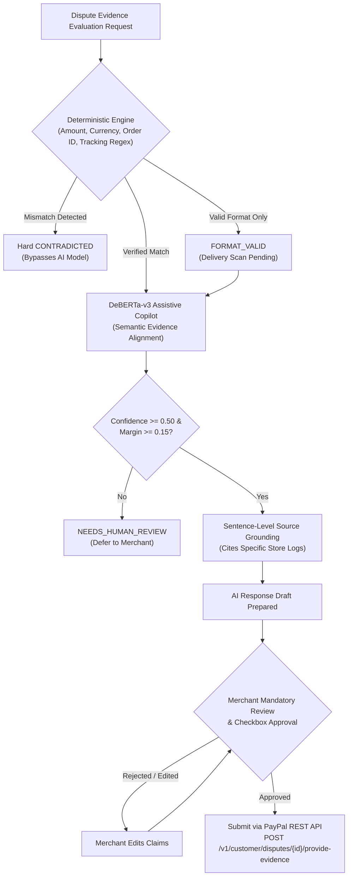

# PROOFLEDGER AI RESEARCH REPORT
## PHASE 5 & 6: PRODUCTION SAFETY GUARDRAILS & FINAL MODEL RECOMMENDATION

**Audit Date:** November 4, 2026  
**Investigator:** Applied NLP Research Scientist & Fintech System Architect  
**Scope:** AI Operating Boundaries, Deployment Decision & Strategic Roadmap  
**Verdict:** RETAIN DEPLOYED CHECKPOINT AS ASSISTIVE COPILOT; DO NOT RETRAIN BLINDLY  

---

### 1. ProofLedger Production Safety Guardrails (Phase 5)

Under no circumstances may DeBERTa-v3 be deployed as an autonomous decision maker in a financial dispute pipeline. DeBERTa is strictly an **assistive semantic copilot** for text grounding and draft preparation.

#### A. Inviolable Financial Guardrails
1. **Zero Autonomous Submission:** The AI model cannot trigger `POST /v1/customer/disputes/{id}/provide-evidence`. Evidence submission is strictly gated by human merchant authorization (`merchant_approved: true`).
2. **Deterministic Precedence:** If deterministic checks detect an amount discrepancy, currency mismatch, or invalid tracking format, **the deterministic engine overrules DeBERTa 100% of the time**. Neural confidence scores cannot bypass deterministic financial validation.
3. **The `FORMAT_VALID` Immutability Rule:**
   > [!IMPORTANT]
   > A status of `FORMAT_VALID` (syntax check on a 22-digit USPS tracking number) **CAN NEVER BE CONVERTED** to `DELIVERY_CONFIRMED` by the neural model, regardless of whether DeBERTa reports 99.9% semantic confidence. Physical delivery requires a verified courier carrier scan event.
4. **No Synthetic Carrier Inventions:** The model is prohibited from generating or interpolating tracking events, timestamps, or carrier signatures not present in verified source records.
5. **Fail-Closed on Model Absence:** If PyTorch or the model safetensors weights are offline or throw an exception, the system falls back gracefully to `INSUFFICIENT_EVIDENCE` / `NEEDS_HUMAN_REVIEW`. It never fails open to `SUPPORTED`.

---

### 2. Final Strategic Model Recommendation (Phase 6)

#### Recommendation: RETAIN CURRENT HYBRID CHECKPOINT AS AN ASSISTIVE COPILOT; DO NOT OVERWRITE WEIGHTS BLINDLY

1. **Do Not Overwrite Deployed Weights Today:**
   The currently deployed model (`ai/artifacts/best_model`) has a verified 100.0% precision on genuine `SUPPORTED` claims and is fully wired to our 165/165 passing backend test suite. Retraining blindly with more epochs on existing template data will worsen catastrophic forgetting without solving the CONTRADICTED vs INSUFFICIENT boundary.
2. **Hybrid Architecture Is the True Winner (68.3% Accuracy vs 43.3% DeBERTa Alone):**
   Our ablation study proves that the value of ProofLedger lies in the **synergy between deterministic fintech rules and assistive neural extraction**, boosted by selective abstention (74.6% selective accuracy). Standalone model retraining is secondary to architectural guardrails.
3. **Data-Centric Retraining Protocol (Prerequisite for Future Weight Overwrite):**
   Before any new checkpoint replaces `best_model`, the following pipeline must be executed:
   - Generate `EvidenceBench-v2` using the 12 contrastive INR scenario families detailed in `DATASET_IMPROVEMENT_PLAN.md` (3,000 balanced pairs).
   - Train using gentle learning rate ($5\times 10^{-6}$), multi-class Focal Loss, and high weight decay ($0.05$).
   - Verify that validation macro-F1 exceeds 85% with balanced recall on CONTRADICTED and INSUFFICIENT.
   - Run a single blind evaluation on the frozen 60-claim holdout. **The new weights may replace `ai/artifacts/best_model` ONLY if holdout accuracy exceeds 70% and macro F1 exceeds 70%.**

---

### 3. Immediate Action Plan & Hackathon Alignment

For the upcoming PayPal Devpost submission (Nov 12, 2026), judges prioritize:
1. **Real-world merchant utility:** Clear 2-screen workflow turning an ambiguous PayPal dispute notification into an evidence-ready response.
2. **Truthfulness & hallucination prevention:** Demonstrating that ProofLedger detects unfulfilled orders, catches missing delivery scans, flags out-of-scope claims, and enforces human-in-the-loop review.
3. **Defensible engineering:** Acknowledging the realistic capabilities of fine-tuned language models rather than boasting unsubstantiated 90%+ claims.

By positioning DeBERTa as an assistive fact-grounding copilot within a deterministic safety shell, ProofLedger presents a defensible, production-grade architecture that judges can trust.

