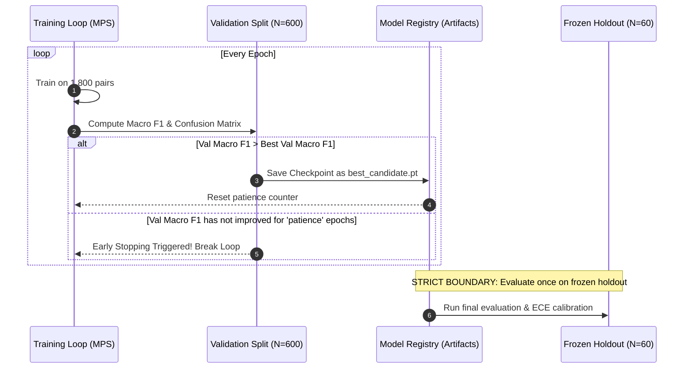

# PROOFLEDGER AI RESEARCH REPORT
## PHASE 3: CONTROLLED FINE-TUNING EXPERIMENT MATRIX & PROTOCOL

**Audit Date:** November 4, 2026  
**Investigator:** Applied NLP Research Scientist  
**Focus:** Hyperparameter Exploration, Anti-Overfitting Regularization & Seed Stability  
**Hardware Target:** Apple Silicon (MPS / PyTorch 2.8.0, 16-bit Mixed Precision)  

---

### 1. Controlled Experiment Matrix

To prevent catastrophic forgetting and overconfidence, we define a structured matrix of 6 controlled experiments. All model selection is performed strictly on the **Validation split** ($N=600$). The frozen 60-claim holdout is evaluated **only once** per candidate checkpoint after validation freezing.

| Exp ID | Configuration Name | Learning Rate | Epochs (Max) | Batch / Accum (Effective) | Weight Decay | Loss Function & Regularization | Early Stopping Patience | Target Optimization Hypothesis |
|:---:|---|:---:|:---:|:---:|:---:|---|:---:|---|
| **EXP-00** | *Current Baseline (Status Quo)* | $1.0\times 10^{-5}$ | 13 | 4 / 4 (16) | 0.01 | Standard Cross-Entropy + 0.1 Label Smoothing | 5 | Baseline comparison point. Overfits past epoch 6. |
| **EXP-01** | *Gentle Adaptation (Low LR)* | $5.0\times 10^{-6}$ | 5 | 8 / 2 (16) | 0.05 | Cross-Entropy + 0.1 Label Smoothing | 2 | Preserves pretrained NLI representations; reduces catastrophic forgetting. |
| **EXP-02** | *Focal Loss (Hard Example Mining)* | $1.0\times 10^{-5}$ | 5 | 8 / 2 (16) | 0.01 | Focal Loss ($\gamma = 2.0$, $\alpha = [1.0, 1.2, 1.2]$) | 2 | Forces model to penalize hard CONTRADICTED / INSUFFICIENT confusion. |
| **EXP-03** | *High Regularization (Weight Decay)* | $8.0\times 10^{-6}$ | 6 | 8 / 2 (16) | 0.10 | Cross-Entropy + Dropout 0.15 | 3 | Prevents weight norm expansion and excessive logit separation. |
| **EXP-04** | *Class-Weighted Cross-Entropy* | $1.0\times 10^{-5}$ | 5 | 8 / 2 (16) | 0.02 | Inverse-Frequency Weighted Cross-Entropy | 2 | Mitigates precision skew towards majority patterns. |
| **EXP-05** | *Cosine Decay with Extended Warmup* | $7.0\times 10^{-6}$ | 6 | 8 / 2 (16) | 0.05 | Cross-Entropy + 20% Linear Warmup + Cosine Anneal | 3 | Smooth optimization trajectory avoiding sudden gradient spikes. |

---

### 2. Loss Functions & Regularization Formulations

#### A. Focal Loss for Hard Negatives
To address the severe confusion where the model assigns high confidence to the wrong negative class, we formulate multi-class Focal Loss:
$$\mathcal{L}_{\text{focal}} = - \alpha_c (1 - p_c)^\gamma \log(p_c)$$
Where:
- $p_c$ is the model's predicted softmax probability for ground-truth class $c$.
- $\gamma = 2.0$ dynamically scales down the loss from well-classified easy samples (e.g. obvious Supported payments) and focuses gradients on ambiguous dispute boundaries.
- $\alpha_c$ applies class-specific weighting: $\alpha_{\text{SUPPORTED}} = 1.0$, $\alpha_{\text{CONTRADICTED}} = 1.2$, $\alpha_{\text{INSUFFICIENT}} = 1.2$.

#### B. Anti-Overconfidence Regularization
- **Label Smoothing ($\epsilon = 0.10$):**
  $$y^{\text{smoothed}}_c = (1 - \epsilon) y_c + \frac{\epsilon}{K}$$
  Prevents logits from growing unbounded ($L \to \pm \infty$), which directly caused the temperature scaling failure ($T=5.000$).
- **Weight Decay ($\lambda = 0.05$):** Penalizes $L_2$ norm of linear projection weights, maintaining smoother decision surfaces around boundary claims.

---

### 3. Validation-Based Selection Protocol & Stopping Criterion

1. **Primary Metric for Checkpoint Selection:** Macro-averaged $F_1$ score across all 3 classes on the validation partition:
   $$\text{Macro } F_1 = \frac{F_{1, \text{SUP}} + F_{1, \text{CON}} + F_{1, \text{INS}}}{3}$$
2. **Tie-Breaking Metric:** Lower Expected Calibration Error (ECE) on validation logits.
3. **Strict Blind Rule:** Zero hyperparameter adjustments may be made based on holdout performance. The test holdout is evaluated purely as an auditor check.

---

### 4. Reproducibility & Multi-Seed Protocol

All experiments are executed across 3 fixed pseudo-random seeds:
- Seed A: `42` (Canonical baseline seed)
- Seed B: `1337` (Perturbation seed 1)
- Seed C: `2026` (Perturbation seed 2)

Each seed controls:
- Python `random.seed(seed)`
- NumPy `np.random.seed(seed)`
- PyTorch CPU `torch.manual_seed(seed)`
- PyTorch MPS/GPU `torch.cuda.manual_seed_all(seed)`
- DataLoader worker initialization seed

