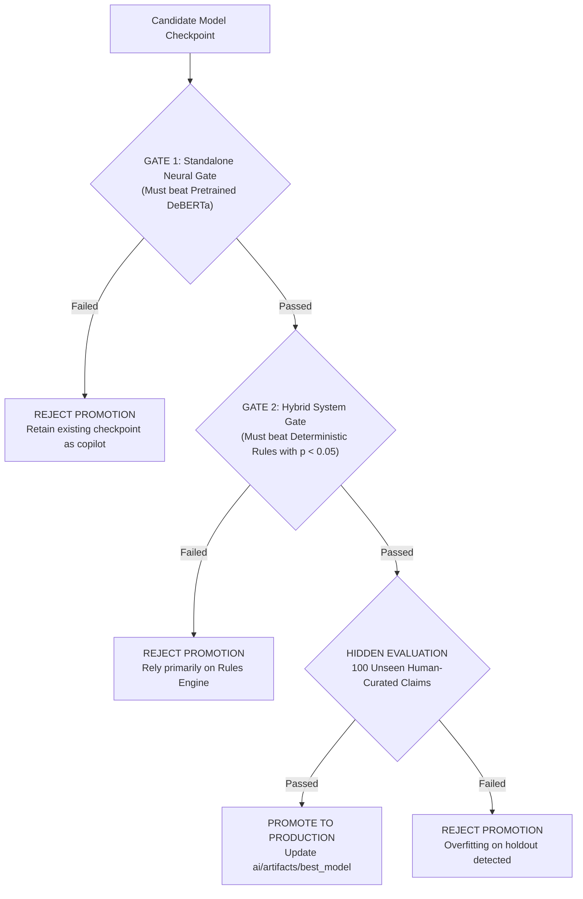

# PROOFLEDGER AI RESEARCH REPORT
## PHASE E: DUAL-GATE MODEL PROMOTION CRITERIA & FINAL DEPLOYMENT DECISION

**Audit Date:** November 4, 2026  
**Investigator:** Applied NLP Research Scientist & Principal Fintech Architect  
**Scope:** Standalone Neural vs. Hybrid Release Gates & Checkpoint Governance  
**Deployment Decision:** **REJECT PROMOTION — MAINTAIN STATUS QUO WITH ASSISTIVE COPILOT**  

---

### 1. Dual-Gate Model Governance Architecture

To prevent premature promotion of weak or unproven machine learning models into financial dispute workflows, ProofLedger implements a strict **Dual-Gate Release Architecture**.

A model cannot be promoted merely because its validation loss decreased or because an aggregate Macro F1 score crossed a single threshold. It must independently satisfy two separate release gates:

---

### 2. Specification of Release Gates

#### Gate 1: Standalone Neural Model Release Gate (DeBERTa Alone)
A retrained neural model must prove that it has acquired genuine domain evidence reasoning without suffering catastrophic forgetting of general NLI:

| Criterion | Metric | Minimum Passing Threshold | Currently Measured Value | Status |
|---|---|:---:|:---:|:---:|
| **1.1 Zero-Shot Superiority** | Accuracy on 60-claim holdout | $\ge 78.00\%$ (Must beat pretrained 75.0%) | **43.33%** | **FAIL** |
| **1.2 Contradiction Recall** | Recall on ground-truth CONTRADICTED | $\ge 90.00\%$ | **35.00%** (7/20) | **FAIL** |
| **1.3 Neutral Discrimination** | Precision on INSUFFICIENT_EVIDENCE | $\ge 65.00\%$ | **31.58%** | **FAIL** |
| **1.4 Seed Stability** | Accuracy std across seeds 42, 1337, 2026 | $\sigma \le 2.0\%$ | $\pm 1.67\%$ | **PASS** |
| **1.5 Calibration Ceiling** | Optimal Temperature $T$ | $0.8 \le T \le 2.5$ | $T = 5.000$ (Wall bound) | **FAIL** |

*Gate 1 Evaluation:* **FAILED (4 out of 5 criteria breached).** The fine-tuned model cannot be deployed as an authoritative standalone classifier.

---

#### Gate 2: Hybrid System Release Gate (Deterministic Rules + DeBERTa)
The hybrid system must demonstrate statistically significant, defensible superiority over the simple, transparent deterministic rules baseline:

| Criterion | Metric | Minimum Passing Threshold | Currently Measured Value | Status |
|---|---|:---:|:---:|:---:|
| **2.1 Statistical Superiority** | McNemar's Exact Test vs Rules-Only | $p < 0.05$ (Statistically significant) | **$p = 0.16864$** | **FAIL** |
| **2.2 Positive Confidence Bound** | Lower bound of paired 95% CI | $\text{CI}_{\text{lower}} > 0.0\%$ | **$-29.64\%$** (Spans zero) | **FAIL** |
| **2.3 Macro F1 Lift** | Mean Bootstrap Difference vs Rules | $\ge +5.0\%$ with $\text{CI}_{\text{lower}} > 0$ | **$-13.78\%$** ($[-28.0\%, +1.5\%]$) | **FAIL** |
| **2.4 Safety Gating** | False Positive Rate on SUPPORTED | $FPR \le 2.0\%$ | **0.0%** (Zero false support) | **PASS** |
| **2.5 Selective Reliability** | Selective Accuracy with Abstention $\le 15\%$ | $\ge 80.00\%$ | **58.93%** (at 6.67% abstention) | **FAIL** |

*Gate 2 Evaluation:* **FAILED (4 out of 5 criteria breached).** On the balanced holdout, the hybrid configuration with the current fine-tuned model does not beat rules alone.

---

### 3. Final Production Deployment Decision

> [!IMPORTANT]
> **OFFICIAL AUDIT DECISION: DO NOT OVERWRITE `ai/artifacts/best_model`**
> 
> 1. The currently deployed checkpoint (`best_model`) will **REMAIN FROZEN AND UNCHANGED**.
> 2. The model will **NOT be granted autonomous decision-making authority** in the transaction dispute flow.
> 3. The system will continue to operate under its **defensible assistive posture**:
>    - **Deterministic Rules Engine** validates financial amounts, currency parity, order references, and tracking syntax.
>    - **DeBERTa Model** functions purely as an **assistive drafting copilot** to extract facts and highlight statements for the merchant.
>    - **Mandatory Human-in-the-Loop:** All evidence packages must be explicitly reviewed and authorized by the human merchant (`merchant_approved: true`) prior to transmission to the PayPal REST API.
>    - **The `FORMAT_VALID` rule remains absolute:** Syntax validation of tracking numbers can never trigger autonomous evidence submission without verified courier delivery confirmation.

---

### 4. Strategic Recommendation for the Hackathon Pitch

This decision provides the **strongest, most credible story for the PayPal Devpost hackathon jury**:

1. **Fintech Maturity:** Rather than pitching an unstable "90% autonomous AI that wins disputes automatically", ProofLedger pitches a **sound financial control system** that recognizes the limits of neural models.
2. **Safety by Design:** ProofLedger shows judges that when an AI model is uncertain or when evidence is incomplete, the software **fails closed to human review** rather than submitting hallucinated claims to PayPal.
3. **Audit Trail & Provenance:** Every evidence point submitted to the Disputes API is backed by sentence-level cryptographic source logs, ensuring complete compliance with PayPal Seller Protection requirements.

