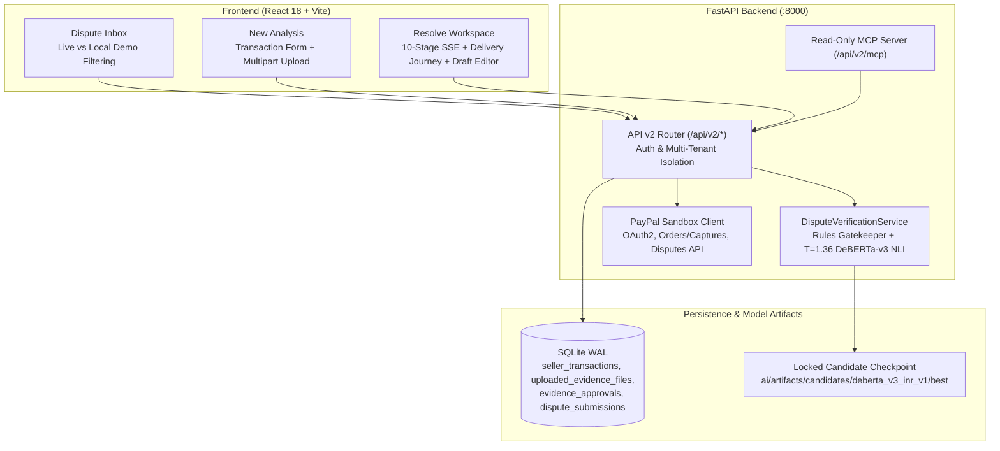

# ProofLedger System Architecture

## 1. Design Principles

ProofLedger handles financial dispute preparation around three strict invariants:
1. **Deterministic Rules Supersede Neural Confidence**: Order linkage, payment capture amount/currency matching, tracking regex syntax (`FORMAT_VALID`), and chronological ordering are enforced deterministically before or over neural NLI predictions.
2. **Evidence Provenance Separation**: Merchant-supplied attestations and uploaded files are explicitly separated from independently verified third-party records (PayPal REST API and carrier APIs).
3. **Fail-Closed Execution**: Missing model checkpoints return `MODEL_UNAVAILABLE` without silent fallback; unapproved or post-approval-modified drafts are rejected before submission; local demo disputes cannot submit to live PayPal.

---

## 2. High-Level Component Architecture

---

## 3. Verification & Dispute Resolution Pipeline

### A. 10-Stage Real-Time SSE Orchestration
`POST /api/v2/disputes/{dispute_id}/analyze-stream` streams sequential verification progress events to the UI (`retrieve_dispute` -> `read_requested_evidence` -> `link_payment_order` -> `validate_amount_currency` -> `validate_tracking` -> `check_delivery_evidence` -> `semantic_nli` -> `identify_gaps` -> `prepare_grounded_response` -> `ready_for_review`), culminating in a `complete` payload containing grounded draft text, per-claim verdicts, missing evidence items, and a canonical SHA-256 `evidence_digest`.

### B. Hybrid Verification & Calibration
- **Candidate Model**: Fine-tuned `MoritzLaurer/DeBERTa-v3-base-mnli-fever-anli` at `ai/artifacts/candidates/deberta_v3_inr_v1/best` (`[0: SUPPORTED, 1: CONTRADICTED, 2: INSUFFICIENT_EVIDENCE]`).
- **Calibration**: Validation-fitted temperature scaling (`T = 1.36` on EvidenceBench-v2 validation `N = 450`; NLL `0.4068 -> 0.3879`) applies **only** when the matched `deberta_v3_inr_v1` checkpoint is loaded.
- **Safety Gatekeeper**: Mismatched transaction references, unverified claims involving `"download"` / portal access keywords without server logs, or non-verified tracking assertions are overridden deterministically to `INSUFFICIENT_EVIDENCE`.

### C. Delivery Verification Journey & Attachment Honesty
[`DeliveryJourney.jsx`](../frontend/src/components/verification/DeliveryJourney.jsx) enforces a strict state separation:
- **Provenance Strip**: Distinguishes `Merchant Attestation & Uploads` (`MERCHANT_ATTESTATION / FORMAT_VALID`) from `Independent Carrier Verification` (`LOOKUP_NOT_CONFIGURED`).
- **Step `01` (Tracking Supplied)**: Valid syntax shows `FORMAT_VALID` — never implies physical shipment.
- **Step `02` (Carrier Pickup)**: Stays `NOT VERIFIED` unless backed by a verified carrier pickup scan.
- **Step `06` (Delivered)**: Renders `VERIFIED` (`DELIVERY_CONFIRMED`) **only** when a verified courier delivery record and timestamp are present. Merchant-entered delivery dates render `Delivery Claimed by Merchant (Unverified)` (`MERCHANT_ATTESTATION`), and absent dates render `Delivery Confirmation Pending`.
- **Attachment Hashing**: Uploaded PDF/JPG/PNG files are persisted in `uploaded_evidence_files` and surfaced as `SHA-256 integrity verified` and `CONTENT_NOT_EXTRACTED`. ProofLedger does not claim OCR extraction or AI verification of attachment bytes.

---

## 4. Cryptographic Approval Binding & Tenant Isolation

- **Multi-Tenant Isolation**: Authenticated sellers resolve via bearer token; SQLite queries filter strictly by `seller_id`.
- **Server-Side Approval Binding**: `POST /api/v2/disputes/{dispute_id}/approve-evidence` computes and persists an `approval_id` (`EAPPR-*`) bound to `(seller_id, dispute_id, evidence_digest)` in `evidence_approvals`.
- **Tamper & Stale Guard**: Modifying carrier, tracking, draft text, or attachment URL after approval triggers immediate UI invalidation and returns `HTTP 409 STALE_OR_MODIFIED_APPROVAL` from `provide-evidence`.
- **Local vs. Live Guard**: Submitting a local demo case (`DSP-*`) with `require_live_paypal=true` returns `HTTP 400 LOCAL_DEMO_NOT_LIVE_PAYPAL`.

